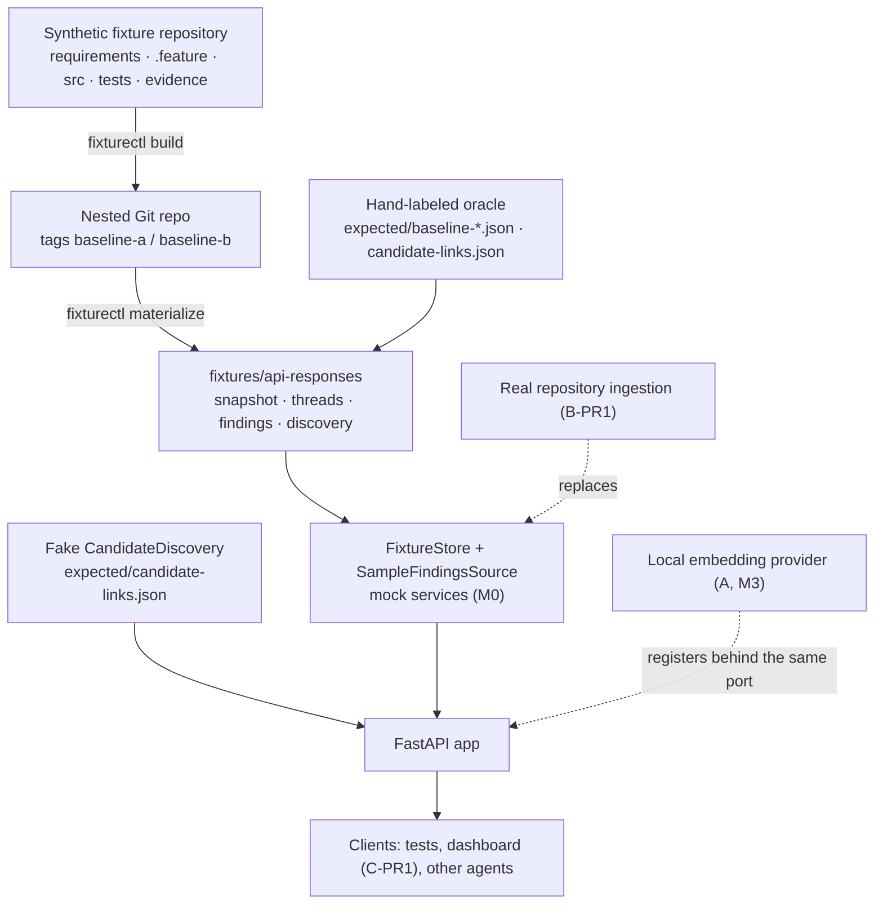

# Architecture

## Shape

Two rules explain most of the layout:

1. **The oracle is a first-class input.** Hand-labeled files (`expected/*.json`) plus a
   *generated* snapshot are the shared input for every workstream, and the generated files are
   drift-checked (`fixturectl.py verify`, CI, and a test).
2. **Everything reachable from the API is behind a port.** Routes that read the thread's facts
   depend on `ArtifactRepository` (`RepositoryDep`), not on `FixtureStore`: artifacts, artifact
   lists, links, evidence, changed artifacts, and baseline resolution all go through the port.
   Two surfaces are explicitly fixture-only and are named as such in the code: the precomputed
   thread replay (`FixtureStore.thread`, replaced by DT-04) and the sample-findings source
   (`SampleFindingsSource`, replaced by AS-01…AS-03).

## Modules

| Module | What it is | Status |
| --- | --- | --- |
| `app/domain/enums.py` | Closed vocabularies: artifact types, relations, review states, finding types, rule ids, severities | Contract |
| `app/domain/models.py` | `Artifact`, `TraceLink`, `VerificationEvidence`, `TraceCandidate`, `AssuranceFinding`, fingerprint function | Contract |
| `app/domain/api.py` | Request/response envelopes, problem document | Contract |
| `app/domain/ports.py` | `ArtifactRepository`, `CandidateDiscovery`, `AssuranceEvaluator`, `ReviewService` | Contract (projects the interfaces for M1+) |
| `app/domain/oracle.py` | Schemas of fixture inputs and generated snapshot | Contract |
| `app/domain/policy.py` | Rule → finding type and severity policy | Contract |
| `app/persistence/` | `FixtureStore`: reads `snapshot.json` and precomputed thread responses | Mock service |
| `app/discovery/fake.py` | Fixture-backed candidate provider | Working implementation (deliberately fake) |
| `app/assurance/sample_findings.py` | Replay of reviewed sample findings | Mock service (rule engine arrives in C-PR1) |
| `app/api/` | Routes, dependencies, RFC 9457 problem documents | Working |
| `app/ingestion/` | Revision-pinned parsing: requirement/Gherkin artifacts (DT-01), source/test annotations (DT-02), links (DT-03), store cutover (DT-04) | Requirements, scenarios, source, test, and links implemented; store cutover remains |
| `frontend/` | React/TypeScript dashboard | Absent by design; created in C-PR1 |

## Request flows

**Read a thread.** `GET /api/threads/{id}?baseline=…` → the baseline expression is resolved to a
canonical baseline (`FixtureStore.resolve_baseline`) → the precomputed thread response for that
baseline is loaded and validated against `ThreadResponse` → returned. Accepted links, proposals,
and evidence are separate arrays, so a caller that walks only `accepted_links` cannot be misled by
a proposal.

**Propose candidates.** `POST /api/discovery` → source artifact existence is checked (404
otherwise) → `ProviderRegistry.get(name)` returns the provider (400 for an unknown name) →
`discover()` filters the labeled index, sorts by score, trims to `top_k`, and attaches provider
identity and index revision. The candidate type has no link id and no review state, so this path
cannot accept anything.

**Regenerate fixtures.** `fixturectl build` replays `history.json` with fixed identity, dates, and
messages so commit SHAs are reproducible; `materialize` scans each tagged revision for artifacts
and evidence, stamps oracle findings with revisions and fingerprints, assembles threads, and
writes the responses. `verify` does all of that into a temporary directory and diffs.

## What is real and what is not

| Claim | Reality at this snapshot |
| --- | --- |
| Git history, tags, and revisions | Real. Four commits, fixed SHAs, verified reproducible. |
| Artifact identity, content hashes, revisions | Real, computed from git blobs. |
| Fixture tests passing/failing as labeled | Real: the suite runs the fixture's own tests at both tags. |
| Findings | **Not computed.** Reviewed sample responses generated from the hand-labeled oracle. |
| Retrieval quality | **Not measured.** Candidate scores are fixture labels, never model output. |
| Ingestion from a real repository | Requirements and Gherkin scenarios are parsed from the nested fixture repository at a pinned revision (DT-01). Source/test artifacts, links, and the API cutover land in DT-02…DT-04; `POST /api/ingestion/run` still returns 501 until DT-04. |
| Link review and audit history | Not implemented; `POST /api/links/{id}/review` returns 501 naming AS-06. |

This is why the `contract-only` endpoints return 501 instead of plausible-looking data: the
project's whole premise is that a reader can tell facts, proposals, and verification apart.

## Versioning and compatibility

`SCHEMA_VERSION` (in `app/version.py`) versions the contract set. Additive changes bump the
minor, breaking changes the major, and fixture files record the version they were written
against — loaders reject mismatches loudly instead of proceeding. Responses carry
`schema_version` so consumers can detect a contract change at runtime.

## Decisions

Recorded as ADRs in `docs/adr/`:

| ADR | Decision |
| --- | --- |
| 0001 | Monorepo layout, `uv` + `backend/pyproject.toml`, package name `app` |
| 0002 | Fixture strategy: declarative history, generated nested repo, generated API samples, drift check |
| 0003 | Artifact identity, revisions, and content-hash freshness |
| 0004 | Proposals vs accepted links; the fake discovery contract |
| 0005 | Initial evidence-freshness policy and its assumptions |
| 0006 | Deferred decisions: storage engine, embedding provider, graph semantics, frontend stack, auth |
