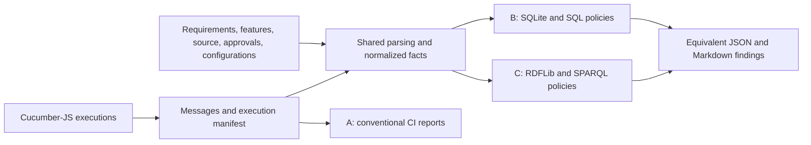

# Continuous traceability assurance beyond CI using Gherkin-based knowledge graphs

Research and implementation proposal · 11 November 2026

**Recommendation:** Build a deterministic traceability assurance tool and evaluate two backends: SQLite and an in-process RDFLib graph. Use the same requirement baselines, Gherkin files, approval records, and execution reports in both. Expect most detection benefits to come from explicit policies and automation. Treat any additional benefit from the graph representation as an experimental question.

**Evidence status:** This report synthesizes literature and official documentation, specifies an architecture and experiment, and provides a worked demonstration. It does not report a completed comparative experiment or an implemented `traceguard` CLI. Example executions, graph records, and reports below are illustrative, not collected verification evidence. Numerical thresholds are proposed acceptance criteria, not observed results.

**Repository boundary:** [STATUS.md](STATUS.md) records M0's independently approved foundation, fixture services, and outstanding landing work. General ingestion, baseline-aware assurance, and empirical comparison are subsequent work. This report does not change the roadmap, milestone state, domain contracts, fixtures, or deferred architecture decisions. Its proposed entities and state names exceed schema 0.1.0 and require reviewed contract changes before implementation. The current banking fixture remains the M0 oracle; the warning example below is a proposed additional benchmark, not a replacement.

## 1. Problem validation and the incremental assurance gap

The engineering problem is credible; the necessity of a knowledge graph remains unproven. Requirements-to-test links can decay as artifacts evolve. Software execution results, artifact relationships, approvals, and configuration information often live in different tools. Passing a test answers a narrower question than whether the current approved obligation has an adequately reviewed verification strategy.

Define the incremental gap precisely:

> At target requirement baseline B, software commit X, and configuration Y, the executed scenarios pass, but an approved relationship connecting a revised engineering obligation to its behavioral specification has no recorded reassessment for the changed content.

The absence of reassessment is an assurance-process finding under an explicit policy. It is not evidence of a software defect. The tool must distinguish an absent review record in a complete local ledger from an unavailable review ledger; the latter supports `UNKNOWN`, not an assertion that nobody reviewed the change.

### Research evidence and its limits

| Source | Source-supported finding | Implication and limit |
| --- | --- | --- |
| Wohlrab et al., *Collaborative traceability management* (online 2018; volume 2020) | Interviews with 24 individuals from 15 industrial projects identify team/tool boundaries and trace maintenance among the challenges. | Supports investigating integration and ownership; does not establish how prevalent any particular DOORS deployment pattern is. [Study](https://link.springer.com/article/10.1007/s00766-018-0306-1) |
| Tian et al., *The Impact of Traceability on Software Maintenance and Evolution* (2021) | Mapping of 63 studies identifies link establishment/maintenance as a major cost and calls for stronger industrial evidence. | Motivates measuring effort, not assuming savings; a mapping study does not establish graph-specific causation. [Accepted preprint](https://arxiv.org/abs/2108.02133) |
| Mäder and Gotel, *Towards automated traceability maintenance* (2012) | Studies rule-based maintenance of links during evolution. | Change-triggered link maintenance is established prior work, not a new contribution here; its model-driven setting differs from Gherkin CI. [Publication record](https://pubmed.ncbi.nlm.nih.gov/23471308/) |
| Mäder and Egyed, *Do developers benefit from requirements traceability when evolving and maintaining a software system?* (2015) | Controlled experiment with 71 subjects reports benefits for maintenance tasks with traceability. | Justifies a controlled effort experiment; does not compare RDF with SQL or justify transferring its effect sizes to this MVP. [Authors' institutional record](https://research.jku.at/en/publications/do-developers-benefit-from-requirements-traceability-when-evolvin/) |
| Fucci, Alégroth, and Axelsson, *When Traceability Goes Awry* (2022) | An industrial collaboration encountered missing requirement-to-test links that obstructed its intended quality investigation. | Provides a concrete failure of available trace data, not evidence that all commercial platforms lack the capability. [Experience report](https://arxiv.org/abs/2206.04462) |
| Bjarnason et al., *A multi-case study of agile requirements engineering and the use of test cases as requirements* (2016) | Three-company study, 14 interviews and two focus groups, identifies several practices and both benefits and challenges. | Supports exploring Gherkin-first requirements without assuming universal suitability. [University publication record](https://lup.lub.lu.se/search/publication/837cc0aa-0f43-420d-aaad-72c67201992b) |
| Binamungu and Maro, *Behaviour Driven Development: A Systematic Mapping Study* (2023) | Maps 166 papers and reports limited industrial insight and a shortage of BDD metrics. | Supports modest claims and explicit measures of specification quality and effort. [Accepted preprint](https://arxiv.org/abs/2305.05567) |
| Warg et al., *Continuous Deployment for Dependable Systems with Continuous Assurance Cases* (2019) | Proposes integrating modular assurance cases, contracts and iterative assessment with development. | Continuous assurance is prior art; this is a proposed process, not experimental evidence that this MVP ensures safety. [Authors' paper](https://warg.org/fredrik/publ/wosocer2019/ContinuousAssuranceCases_AuthorVersion.pdf) |
| Zeller, *Towards Continuous Safety Assessment in Context of DevOps* (2021) | Outlines a continuous-delivery pipeline using model-based safety assessment. | Places CI integration in a broader assurance research context; automated traceability alone does not implement model-based safety assessment. [Preprint](https://arxiv.org/abs/2106.07200) |
| Hedberg, Bajaj, and Camelio, *Using graphs to link data across the product lifecycle for enabling smart manufacturing digital threads* (2019 publication record) | Describes a graph-based prototype and information round-trip across design, manufacturing and quality domains. | Supports the digital-thread integration concept, but its manufacturing case does not demonstrate advantages for Gherkin assurance or against an equivalent SQL baseline. [NIST publication record](https://www.nist.gov/publications/using-graphs-link-data-across-product-lifecycle-enabling-smart-manufacturing-digital) |
| *Application of knowledge graph in software engineering field: A systematic literature review* | Reviews KG applications in software engineering. | Establishes a research landscape, not superiority for this task. Only the indexed abstract was accessible here; detailed results were not independently inspected. [Publisher abstract](https://www.sciencedirect.com/science/article/pii/S0950584923001829) |

This is a targeted literature review, not a systematic review. Searches covered traceability maintenance, industrial experience, tests as requirements, BDD, knowledge graphs, provenance, and the named tools. Preference was given to research publications, authors' institutional repositories, standards organizations, regulators, and official product documentation. Abstract-level findings are kept at that level. Vendor documentation establishes available functionality, not adoption, effectiveness, or deployment prevalence. No industry interviews or commercial installations were evaluated for this report.

The defensible research contribution is a reproducible artifact and an honest three-way comparison of assurance detection and report production. A claim of first-ever continuous traceability, suspect links, requirements-based testing, or configuration-aware evidence would be unsupported.

## 2. Continuous testing, traceability, and verification

| Question | What can establish it? | What does not follow? |
| --- | --- | --- |
| Did scenario S pass at X under Y? | Identified execution record with trustworthy provenance. | That S covers all of requirement R. |
| Does R reference S? | An extracted tag or explicit source reference. | That an engineer approved the association. |
| Is rule BR approved for R Revision B? | An effective review decision tied to the relevant content versions. | That the implementation satisfies either artifact. |
| Is the passing execution usable for a selected claim? | Explicit applicability policy plus configuration and dependency information. | Universal correctness or complete requirement verification. |
| Is an expected link absent? | Complete, declared inventory and scoped validation policy. | That the implementation is absent. |

CI already executes tests on revisions, identifies failures, publishes reports, and can run arbitrary traceability scripts. Adding a traceability job is itself an extension of CI. The relevant distinction is the information and policy being checked, not whether the job runs inside or outside CI.

Traceability freshness concerns whether approved engineering associations still apply to the selected content. Execution freshness concerns the applicability of a particular run to a particular target. They can differ: a new passing run can coexist with an unreviewed requirement association, while an older run can remain applicable to unchanged tested content under an allowed configuration.

An assurance case additionally connects claims, arguments, assumptions and evidence. This MVP supplies inspectable trace paths and policy findings; it does not generate a complete assurance argument. Likewise, a digital thread connects identified lifecycle records across engineering domains; selecting graph storage alone does not create that integration. The continuous-assurance and digital-thread studies in Section 1 motivate these distinctions rather than establish this project's hypotheses.

## 3. Gherkin-first behavioral requirements

Adopt Gherkin-first only for explicitly approved software behavioral obligations. `Feature` supplies capability and context; `Rule` carries the normative behavioral obligation; scenarios illustrate concrete cases. Step definitions supply an executable interpretation. Upstream requirements, hazards, architecture constraints, and non-executable verification obligations retain independent identities and ownership.

Cucumber defines `Rule` as a grouping for a business rule and its illustrative scenarios. It matches step text to step definitions; it does not execute the natural-language meaning of a rule or feature description. Therefore, rule approval and test-implementation review are separate activities. [Gherkin reference](https://cucumber.io/docs/gherkin/reference/)

Proposed authoring discipline:

1. Identify each normative rule explicitly, with an owner, approval decision, source location, and immutable content hash. A title alone is not a stable identity.
2. Keep the normative wording once in the `.feature` file. Approval records point to that wording; a separate database need not duplicate it.
3. Declare upstream references separately from claims that their allocation is adequate. A tag is an assertion in a file, not an approval.
4. Give each scenario an explicit stable ID. Give outline rows a stable case key when cross-version row identity is required; otherwise scope row identity to the outline version and report that limitation.
5. Review boundary cases, negative cases, units, timing origin, observable outputs, and step implementations. A step named “within 100 milliseconds” must actually assert the relevant interval.
6. Maintain a scoped verification strategy for obligations that require analysis, inspection, simulation, stress testing, or independent review. Record the verification method instead of requiring every obligation to have a scenario.

Finite examples do not enumerate every operating state. Natural-language rules can be ambiguous; steps can be incorrect, stubbed, over-mocked, or weaker than their names. Performance, reliability, cybersecurity, architectural separation, and safety analyses commonly need evidence beyond examples. An approved 100 ms software deadline does not by itself justify the allocation of a one-second system deadline, because detection, transport, scheduling, and physical warning behavior may consume the remaining budget.

RQ5 therefore asks whether the workflow avoids redundant records while preserving agreed obligations and links. It does not ask whether Gherkin replaces safety requirements engineering or proves adequate verification.

## 4. Existing technology and the residual integration problem

| Technology | Documented capabilities relevant here | Residual boundary for this project |
| --- | --- | --- |
| Excel / spreadsheets | An engineered workbook can contain IDs, relationships, review dates, and matrices; scripts can compare revisions and reports. | A fair simple baseline can automate these checks. Reviewable provenance and synchronization still require a deliberate schema and process. |
| IBM DOORS Next / ELM | Configuration-aware link validity and validity summaries; suspect status can signal changed endpoints. Available behavior depends on application/configuration setup. | Reproducing suspect-link detection is not novel. Test a portable Git/Gherkin/report adapter without requiring an ELM installation. [IBM link validity documentation](https://www.ibm.com/docs/en/engineering-lifecycle-management-suite/lifecycle-management/7.1.0?topic=applications-link-validity) |
| Polarion | Linked requirements and tests, test records, automated result integration, and suspect-link workflows exist. | Compare against the concept of enhanced ALM integration, not a straw-man records database. A commercial trial is unnecessary for the MVP. [Official ALM description](https://www.siemens.com/en-us/products/polarion/application-lifecycle-management-alm/), [test-record API concepts](https://developer.siemens.com/polarion/latest/advanced-concepts.html), [suspect workflow extension](https://extensions.polarion.com/extensions/51-workflow-extension-advanced-suspect) |
| Cameo / CATIA Magic ecosystem | Requirements relationships, matrices, ReqIF import, synchronization through DataHub, validation, and suspect-link analysis. | The proposed integration overlaps existing capability. Actual enabled plugins, review workflows, and CI adapters determine deployment behavior. [Official requirements documentation](https://docs.nomagic.com/MT/2026x/magic-cyber-systems-engineer---cameo-systems-modeler/requirements-management-272728870.html) |
| Eclipse Capella | Open-source requirements viewpoint imports ReqIF and supports allocations between requirements and model elements. Its documented editing workflow notes limitations including no ReqIF export. | Useful potential future adapter; importing model data is different from collecting scenario execution evidence. [Requirements viewpoint](https://github.com/eclipse-capella/capella-requirements-vp), [editing guide](https://github.com/eclipse-capella/capella-requirements-vp/blob/master/plugins/org.polarsys.capella.vp.requirements.doc/html/3_userguide/3a_edition.mediawiki) |
| SysML v2 ecosystem | SysML 2.0 and Systems Modeling API and Services 1.0 are published specifications; open reference resources exist. | Formal interchange and API standards reduce integration uncertainty but do not automatically supply a project's execution/evidence policy. Do not describe SysML v2 as only a future proposal. [OMG SysML 2.0](https://www.omg.org/spec/SysML/2.0), [API specification](https://www.omg.org/spec/SystemsModelingAPI/1.0), [reference release](https://github.com/Systems-Modeling/SysML-v2-Release) |
| OSLC | RDF vocabularies and REST-oriented lifecycle integration; configuration management addresses versions/configurations of linked resources. | Reuse vocabulary concepts; no live connector in five weeks. OSLC's existence precludes claiming that linked cross-tool engineering data is novel. [OSLC specifications](https://open-services.net/specifications/) |
| ReqIF | Standard interchange for requirements and their attributes/relations. | A file exchange is not a continuously synchronized approval or execution service. CSV/Markdown suffices to demonstrate the boundary. [OMG ReqIF 1.2](https://www.omg.org/spec/ReqIF/1.2/) |
| Cucumber and test management | Cucumber Messages provides structured test information; Cucumber-JS emits NDJSON. Xray documents Cucumber result imports and environment-related workflows. | Ordinary result collection is already solved. The experiment concerns the applicability of reviewed obligation-to-specification associations. [Messages](https://github.com/cucumber/messages), [formatter documentation](https://github.com/cucumber/cucumber-js/blob/main/docs/formatters.md), [Xray import guidance](https://docs.getxray.app/display/XRAY/Import+Execution+Results+-+REST) |
| Doorstop / StrictDoc | Version-controlled requirements and traceability are available without proprietary licenses. Doorstop checks suspect links using fingerprints; StrictDoc documents requirement/source traceability. | Strong prior art and potential reusable components. Evaluate adapter effort before writing redundant infrastructure; graph-specific novelty remains unestablished. [Doorstop validation](https://doorstop.readthedocs.io/en/latest/cli/validation.html), [StrictDoc traceability guide](https://strictdoc.readthedocs.io/en/stable/stable/docs/strictdoc_01_user_guide-TRACE.html) |

The empirical literature supports the possibility of tool boundaries and maintenance problems; it does not establish that organizations generally use DOORS or MBSE platforms only as manual databases. The residual problem proposed here is **a reproducible, small-team workflow joining Git-versioned obligations, reviewed Gherkin associations, and configuration-specific executions**. Whether that workflow is useful depends on its cost and input quality.

## 5. Research questions and falsifiable hypotheses

**RQ1:** Can versioned, provenance-aware traceability identify missing, broken, or unreviewed relationships that remain after conventional Gherkin CI passes?

**RQ2:** Does it improve detection accuracy or timeliness relative to CI and deterministic relational checks?

**RQ3:** Can it distinguish historical execution facts from evidence applicable to a selected requirement baseline, software revision, and configuration?

**RQ4:** Does graph representation improve expressiveness, explanation, or maintenance relative to relational representation?

**RQ5, exploratory:** Can approved Gherkin rules serve as authoritative behavioral requirements without unnecessary duplication, while preserving upstream traceability and a separate verification strategy?

Pre-register thresholds before running the benchmark. They are engineering targets for this dataset, not general estimates of industrial performance.

| Hypothesis | Independent variables and comparison groups | Procedure and dependent variables | Proposed success criterion | Principal threats / falsifier |
| --- | --- | --- | --- | --- |
| H1: additional assurance detection | A conventional runner vs B enhanced CI vs C graph; controlled change type. | Replay identical changes; measure true gap detections, incremental yield, and detection latency after input arrival. | B and C each detect at least one reviewed genuine gap on a passing A run, including the Revision B review obligation; zero defect claims inferred solely from change. | Seed design favors the checker; an existing configured CI check may already detect it. No additional true detection falsifies H1 for the benchmark. |
| H2: deterministic relationship accuracy | Extractor/policy implementation B vs C; source syntax, missing IDs, duplicates, outlines, and renames. | Compare emitted structural/reference relationships and integrity classifications with a frozen human-reviewed inventory. | Precision and recall each ≥0.95, with raw counts; all duplicate/unresolved-ID controls correctly handled. | Annotated IDs make recovery easier than semantic discovery. Missing links correctly reported as unknown are not extraction false negatives outside declared scope. Performance below threshold fails H2. |
| H3: less maintenance effort | A plus manual trace report vs B vs C; task order counterbalanced. | Participants maintain links/reviews and produce the same report after matched changes; record time, errors, corrections, and workload. | ≥20% lower median time to a correct report for B or C vs A+manual, with no reduction in correctness; disclose initialization cost separately. | Tiny sample, author familiarity, learning and UI effects. Equal/worse time or correctness fails the practical criterion. B=C still supports automation, not graphs. |
| H4: graph-specific advantage | SQLite SQL vs RDFLib/SPARQL, identical authoritative inputs and output contract; query/change task. | Independently implement three fixed tasks and one held-out relationship extension; compare correctness, edit time, errors, explanation-path completeness, code changes, runtime and dependencies. | On a preselected multi-hop/provenance task or held-out extension, C yields ≥20% lower median correct-edit time, no correctness loss, and remains within the agreed resource budget. | Language expertise, implementation quality, shared normalization, task selection, RDFLib vs SQLite maturity. SQL parity or superiority is a legitimate negative result. Shorter queries alone do not satisfy H4. |
| H5: Gherkin-first feasibility | Same behavioral obligations maintained as duplicated requirement records + scenarios vs normative rules + external approval metadata. | Matched revision/report tasks; reviewers assess retained obligations and trace paths, record redundant normative copies and update time. | No lost obligation in the rubric, all required upstream links preserved, fewer duplicated normative records; report time descriptively. | Counting fewer records is partly designed into the workflow. Lost context, poorer review, or extra maintenance can defeat feasibility despite fewer records. |

H2 concerns extracting declared facts, not discovering all true semantic associations. H5 must assess retained meaning independently; a database row containing an ID or approval is not a redundant copy of normative text. RQ3 additionally requires the state-classification benchmark in Section 14. Do not infer semantic coverage precision from identifier extraction precision.

## 6. Three baseline architectures and attribution of benefits

All arms execute the same application/scenarios at the same commits with the same selection and retry settings. B and C receive byte-identical authoritative inventories, content hashes, configuration manifests, link records, review decisions, and runner reports. A's ordinary artifacts are retained for inspection; no custom traceability policies are added to A. Human report tasks in A have access to the same documents, but use the runner's ordinary reporting plus manual examination.



| Dimension | A: conventional Gherkin CI | B: enhanced CI / SQLite | C: RDFLib graph + CI |
| --- | --- | --- | --- |
| Passing/failing/undefined execution | Native runner capability. | Same execution facts. | Same execution facts. |
| Changed obligation without reassessment | Not a native semantic check; may be found manually. | Hash comparison plus approved-link/review join. | Equivalent graph patterns and review records. |
| Missing declared coverage relationship | Not inherently checked. | Scoped anti-join and integrity constraints. | Scoped graph-pattern validation. |
| Configuration-specific evidence | Reports can already carry metadata; a use policy is required. | Explicit configuration predicates and manifests. | Equivalent policy, with provenance paths. |
| Multi-hop queries | Manual navigation or existing integration. | Joins and recursive CTEs. | SPARQL property paths and patterns. |
| Operations | Existing runner and CI artifacts. | Embedded database; no service. | In-process graph; no server or Docker. |
| Expected tradeoff | Low added infrastructure, manual synthesis. | Likely sufficient for P0; strong baseline. | Potentially convenient heterogeneous queries and vocabulary reuse; additional modeling and tooling cost. |

SQLite supports recursive queries over graphs; graph traversal is not an exclusive capability of a graph database. RDFLib implements SPARQL locally. Neo4j/Cypher also expresses graph patterns and variable-length paths, but adding a required server would raise the cost of this comparison. [SQLite recursive CTE documentation](https://www.sqlite.org/lang_with.html), [RDFLib SPARQL](https://rdflib.readthedocs.io/en/stable/intro_to_sparql/), [Cypher patterns](https://neo4j.com/docs/cypher-manual/current/patterns/)

Shared parsing reduces duplication and isolates representation effects. B and C must implement policy/query logic separately rather than sharing a completed finding list. If C is merely a graph visualization of B's results, the study cannot establish graph-based detection. Record shared parser errors separately, since B/C agreement can otherwise conceal the same wrong fact.

Measure two comparisons: A→B estimates benefits from structured inputs and automation; B→C estimates representation effects. A→C alone cannot isolate a graph-specific contribution. Do not give C extra approved dependency links or a richer baseline inventory. If inputs are missing, both B and C abstain identically.

## 7. Mandatory MVP, exclusions, and proposed technology

**Scope target:** 8–12 upstream requirements, 6–10 behavioral rules, 15–25 scenarios including outlines, one small warning-command application, two approved requirement baselines, and isolated mutation cases. These are planning bounds, not an existing dataset size.

| Use case | Minimum implementation and observable acceptance |
| --- | --- |
| UC-01 Gherkin ingestion | Parse existing files read-only with the official parser. Preserve Feature, Rule, Scenario/Outline, Examples/header/rows, Background, ordered steps, tags and their inheritance, doc strings, tables, and source spans. Reject malformed input explicitly. |
| UC-02 requirement import | Import a Git-versioned Markdown/YAML inventory with ID, revision label, status, text, source URI and approval/baseline membership. Optionally CSV, not both formats initially. Reject duplicate active IDs and incomplete baseline manifests. |
| UC-03 relationship construction | Store structural extraction, asserted references, approved associations and provenance separately. Traverse upstream requirement→rule→scenario→instance→execution. Source/test artifacts use explicit identity annotations and manifest associations, not semantic guesses. |
| UC-04 evidence import | Support exactly Cucumber-JS Messages NDJSON plus an execution manifest. Preserve individual attempts, scenario-instance mapping, outcome and available configuration. Reject or quarantine inconsistent/unmapped records. |
| UC-05 completeness/integrity | Detect unresolved IDs, duplicated identities, missing policy-required associations, deleted targets, and wrong endpoint types. An absent inventory or failed import yields incomplete evaluation, not reassuring zero findings. |
| UC-06 revision reassessment | Compare approved requirement content hashes and the endpoint versions recorded by effective review decisions. Produce `NEEDS_REVIEW` for the linked rule when content differs without reassessment. |
| UC-07 CI report | JSON and Markdown include evaluated target, inputs, policy version, limitations, evidence paths, findings, and dispositions. Exit status separates policy attention from invalid inputs and execution failure. |

**Recommended research implementation, pending ADR and story review:** Retain Python/Pydantic for normalization and CLI logic, Python's SQLite support for B, and RDFLib for C. Use the official Python Gherkin parser/compiler; choose Cucumber-JS for the executable benchmark because Messages retains AST-to-execution connections and its message formatter is recommended over legacy JSON. This adds a Node runtime for the benchmark; include that cost in the dependency comparison. Pin compatible runner/parser/message versions and a supported Node version during Week 1 rather than guessing current package versions. [Official Gherkin implementation](https://github.com/cucumber/gherkin), [Cucumber-JS formatter guidance](https://github.com/cucumber/cucumber-js/blob/main/docs/formatters.md)

P1: validated step-definition metadata, explicit code dependency impact, richer environment compatibility rules, extra multi-hop queries, optional PR summaries. P2: semantic adequacy analysis, LLM association proposals, GraphRAG, MCP, live RM/MBSE integrations, whole-program analysis, formal behavioral reasoning. No new web dashboard is required for the research MVP: CLI, JSON and Markdown make the system reviewable. The existing roadmap's UI and AI priorities remain unchanged until the team explicitly revises them.

Gherkin files without stable IDs can still be parsed without modification. Represent their syntax and locations, but classify cross-version identity as unavailable. Do not invent stable IDs from scenario titles. Approved ID mappings or explicit author annotations are required before claiming rename-stable traceability.

## 8. Minimal graph schema, identities, and relationship semantics

Use three identity levels: **logical artifact**, **immutable content version**, and **occurrence at a source revision**. `SYS-WARN-042` is logical identity; Revision A and B identify approved versions; Git SHA identifies a checkout, not freshness. Different SHAs may contain identical artifact bytes. A source occurrence records path, source span, repository, resolved SHA and content-version URI.

| Entity | Minimum fields / semantics |
| --- | --- |
| UpstreamRequirement | Stable external ID and authority. No mutable “verified” flag. |
| RequirementRevision | Requirement identity, approved revision label, exact text hash, status, source occurrence, approval reference. |
| RequirementBaseline | Immutable membership manifest, authority/approval, manifest hash, inventory scope and completeness. |
| Feature / BehaviorRule / Scenario | Logical ID when declared; content-version URI, exact source hash, source span and owning occurrence. Outline is a Scenario subtype. |
| ExecutableScenarioInstance | Scenario version plus examples case key/bindings hash; regular scenario has one instance. Preserve Examples and Step as structural nodes. |
| SourceArtifact / StepDefinition | Declared source/test identity, path, content hash and occurrence. Step-definition associations are optional unless supplied by supported metadata. |
| TestExecution | Immutable per-instance attempt, execution ID, outcome, report digest/URI, tested commit, UTC timestamp and manifest reference. |
| GitCommit | Full resolved SHA and repository identity. Never used as a substitute for content equivalence. |
| ExecutionConfiguration | Immutable digest of observed configuration attributes, with missing attributes explicitly absent. |
| TraceAssociation | Identified engineering association between logical artifacts, typed endpoints, source/provenance and version basis. |
| ReviewDecision | Immutable decision ID, association ID, reviewed endpoint hashes/versions, baseline/scope, disposition, rationale, actor, UTC time; may supersede an earlier decision. |

Every relationship below is version-scoped. Important engineering associations use TraceAssociation/ReviewDecision records, not anonymous edges with uninspectable approval. “Extracted” means source syntax establishes the fact; it does not imply engineering adequacy.

| Relationship and direction | Exact meaning | Authoritative evidence / category |
| --- | --- | --- |
| `SUPERSEDES`: new revision→old revision | Authority declares the old revision replaced in the selected lineage. | Approved inventory, not timestamp ordering; asserted. |
| `MEMBER_OF`: revision→requirement baseline | Baseline includes that exact approved revision. | Approved membership manifest; asserted. |
| `VERSION_OF`: version→logical artifact | Content record belongs to this declared stable identity. | Explicit source ID; extracted with duplicate checks. |
| `ALLOCATED_TO`: requirement revision→rule version | Approved allocation to a software behavioral obligation for that version pair. | Effective association decision and scope; approved, not inferred from a tag. |
| `ILLUSTRATED_BY`: rule version→scenario version | Scenario is syntactically grouped under the rule. | Gherkin AST containment; extracted; adequacy is a separate review. |
| `CONTAINS`: container version→child version | Structural containment in the parsed source. | AST with locations; extracted; no satisfaction semantics. |
| `REFERENCES`: artifact version→requirement identity | Artifact text declares the upstream ID, possibly inherited from a Feature tag. | Exact tag and origin location; extracted assertion, not allocation approval. |
| `INSTANCE_OF`: executable instance→scenario version | Run case instantiates this scenario and, for an outline, this row. | Compiler/runner AST references and bindings; extracted. |
| `MATCHES_STEP_DEFINITION`: step instance→definition version | Runner resolved that concrete step to this definition in this execution context. | Framework metadata; extracted P1, never guessed by a global regex. |
| `DEPENDS_ON`: artifact version→dependency version | Approved/observed dependency under a named scope. | Explicit dependency manifest or validated tool metadata; P1 if not already provided. |
| `HAS_EXECUTION`: instance→TestExecution | This individual attempt executed that exact case. | Runner records plus validated mapping; extracted. |
| `EXECUTED_AT`: execution→GitCommit | Manifest identifies the source revision tested. | Runner wrapper/CI record, cross-checked against the checkout; asserted provenance. |
| `UNDER_CONFIGURATION`: execution→configuration | Manifest describes the observed test conditions. | Captured manifest; asserted, with unknown fields preserved. |
| `VALIDATED_AGAINST`: execution→requirement baseline | Run was commissioned/tagged against this baseline manifest. | Run manifest; does not establish complete validation or verification. |
| `REVIEWED_FOR`: decision→revision or artifact version | Decision explicitly assessed applicability of the association for this content. | Authorized human decision; approved provenance. |

Unverified proposed relationships live in a separate collection/graph. An optional discovery provider returns candidates without link ID or review state, following repository invariants. It never inserts `ALLOCATED_TO`, decisions, or executions. If a person accepts a candidate, a separate service creates the accepted association and its provenance.

### Reification and provenance

Model association L42 as a resource with subject, predicate and object identities. Attach review decisions that name the exact endpoint hashes. Preserve historical decisions when either endpoint changes. Materialize a convenience edge only in the **applicable approved view** for a target; retain L42 and its old decision even if no current view edge can be materialized. RDF reification/association metadata does not itself assert a valid underlying engineering relationship.

Use PROV-O concepts sparingly: artifact versions and reports as entities, parsing/runs/reviews as activities, and tools/reviewers as agents. `wasDerivedFrom` records derivation, not approval. Provenance improves inspectability, but a hash does not authenticate the producer or prove that the report is true. [W3C PROV-O](https://www.w3.org/TR/prov-o/)

## 9. Representation choice and reasoning boundaries

| Representation | Useful strengths | Costs / limits for five weeks | Recommendation |
| --- | --- | --- | --- |
| SQLite relational tables | Constraints, indexes, joins, recursive CTEs, transactions; small dependency footprint. | Versioned provenance requires deliberate schema; arbitrary relation paths may be more verbose. | Implement as the full enhanced-CI baseline, not an intentionally weak comparator. |
| RDFLib + RDF/SPARQL | Explicit URI identity, typed relationships, named snapshots, provenance vocabulary and reusable graph queries; embedded operation. | Reified associations are verbose; RDF alone does not enforce completeness or create trustworthy facts. | Implement the experimental backend in memory, serialize local snapshots. |
| Neo4j/property graph + Cypher | Natural path patterns and properties on relationships. | Server/runtime, packaging and version-specific deployment add overhead; no assumed small-dataset speed benefit. | Compare conceptually; do not implement a third storage backend. |
| RDFS | Small class/subclass and property vocabulary; easy to explain entailment. | Domain/range axioms infer types rather than reject wrong data. | A tiny vocabulary is sufficient; materialization must be explicit if used. |
| OWL | Rich class/property axioms and open-world semantics. | Does not replace validation; complex reasoning and temporal policy are unnecessary here. | Explain its role, omit a full OWL reasoner. |
| SHACL | Portable graph validation and machine-readable constraint violations. | Adds shapes and a validator dependency; human approval and temporal applicability still require custom policy. | One or two shapes for type/cardinality checks if time permits; Python/SPARQL policies remain sufficient. |

These distinctions follow the standards: OWL's open-world semantics differs from closed-world database assumptions; SHACL validates a supplied data graph against shapes; SPARQL supports graph patterns, optional matches and property paths. RDFLib query execution does not silently imply RDFS/OWL reasoning. [OWL primer](https://www.w3.org/TR/owl2-primer/), [SHACL](https://www.w3.org/TR/shacl/), [SPARQL 1.1](https://www.w3.org/TR/sparql11-query/)

**Graph-pattern matching:** Join a particular requirement revision, applicable allocation, rule, scenario instance and execution. The returned path supports “this scenario ran,” not “this requirement is fully satisfied.”

**Multi-hop traversal:** From the warning obligation, traverse allocation→rule→scenario→instance→execution, optionally following validated source dependencies. Return the individual path edges and their provenance; a reachability Boolean alone is a poor explanation.

**Logical entailment:** A declared rule may entail `PotentialExecutionSupport(R,E)` from an applicable approved allocation R→BR, structural BR→S, instance I of S, and execution E of I. This derived statement means an execution is connected to an obligation through the approved thread. It does not entail `Satisfied(R)` or even `AdequatelyCovered(R)`. Store the derivation rule/version and premises. No truth about timing behavior follows merely from the path.

**Open world:** A graph without R→BR might simply be incomplete. Neither RDF nor the application should conclude `Unimplemented(R)` from that absence.

**Closed-world policy:** For every active, in-scope requirement explicitly designated “scenario-based verification,” require at least one applicable approved allocation and an illustrated scenario, provided the requirement, artifact and decision inventories are complete. Failure means “policy-required association absent in this scope.” Requirements using analysis or inspection follow their declared method. If the inventories are incomplete, the corresponding check abstains. SHACL `minCount` or a SPARQL anti-join implements a data policy, not a logical proof of engineering falsity.

## 10. Worked warning example: source, graph, and change

This system is hypothetical. It establishes no real aircraft requirement or timing allocation.

**SYS-WARN-042 Revision A:** When an engine failure is detected, the system shall provide the corresponding warning within one second. The example allocation assigns 100 milliseconds to software warning-command issuance. A separate engineering decision, not the test, justifies that allocation.

An illustrative file with explicit stable IDs:

```gherkin
@SYS-WARN-042 @FEAT-042
Feature: Engine failure warning

  @BR-042
  Rule: Confirmed engine failures trigger a warning within 100 milliseconds

    @SCN-042
    Scenario: Engine failure during cruise
      Given the system is monitoring the left engine
      When a confirmed left engine failure occurs
      Then the warning command is issued within 100 milliseconds
```

The `Then` is intentionally one complete step line. A visually wrapped continuation is not automatically another executable assertion. The official grammar permits Rule tags in current implementations; lock and test the selected parser/runner pair. `FEAT-042` and `BR-042` are proposed benchmark conventions, not existing repository artifact enums. [Gherkin grammar](https://raw.githubusercontent.com/cucumber/gherkin/main/gherkin.berp)

The parser reads the file without rewriting it. It extracts the upstream reference and containment structure. A reviewer separately records L42: `SYS-WARN-042 ALLOCATED_TO BR-042`, accepted against requirement hash `hRA` and rule hash `hBR1`. Source associations identify `CODE-042` and `TEST-042` explicitly. The benchmark implementation uses a controllable clock to exercise warning-command timing; it does not measure aircraft system response or demonstrate worst-case execution time.

Illustrative facts at baseline A:

```text
SYS-WARN-042 --has approved revision--> R42A [content hash hRA]
R42A --MEMBER_OF--> baseline-A
L42 [requirement identity SYS-WARN-042, rule identity BR-042]
D42A [accept L42 for hRA and hBR1, reviewer, UTC time, rationale]
R42A --ALLOCATED_TO [applicable approved view, D42A]--> BR42v1
BR42v1 --ILLUSTRATED_BY--> SCN42v1
I42 --INSTANCE_OF--> SCN42v1
I42 --HAS_EXECUTION--> E42A [PASSED]
E42A --EXECUTED_AT--> X
E42A --UNDER_CONFIGURATION--> integration-linux-v1
E42A --VALIDATED_AGAINST--> baseline-A
```

**Revision B** retains the warning timing obligation and adds “The system shall record an audit event for each confirmed engine failure.” The approved baseline now includes R42B, whose content hash `hRB` differs from `hRA`. The feature file, step definitions and implementation stay unchanged. A new conventional run E42B at commit Y can still pass the warning scenario.

The tool has no rule that understands the new audit obligation semantically. It compares the changed requirement content with the content reviewed by D42A. Because L42's approval does not cover `hRB`, and a complete ledger has no effective decision for `hRB`/`hBR1`, it reports:

> SYS-WARN-042 changed from Revision A to B. Association L42 to rule BR-042 was reviewed against A; applicability to B is unresolved. SCN-042 passed at Y under integration-linux-v1. Review of the revised allocation is required.

The E42B execution remains a valid historical passing record. Under the declared engineering-evidence reuse policy, its use to support the revised obligation is `NEEDS_REVIEW`. The tool does not claim an absent audit implementation, inadequate semantics, or a failed verification. B can find precisely the same gap with SQL joins. That equivalence is central to the experiment.

A reviewer can: (a) record that a separate rule/verification method covers the new obligation, with reasons and links; (b) update BR-042 and its scenarios and collect relevant new evidence; or (c) retain the review obligation. Merely rerunning the unchanged scenario or adding a “reviewed” timestamp without version/scope does not close it. A disposition accepting the old association establishes applicability of that association only; it does not declare the new audit behavior fully verified.

## 11. Concrete graph queries and the relational equivalent

The following SPARQL 1.1 queries are proposed policy/query examples, not existing endpoints. Prefix `ex:` means `urn:traceguard:`. In each named snapshot, artifact versions and baseline membership are explicit; `versionOf` connects a version to its logical identity. `ActiveAssociation` means an association has not been withdrawn in the selected ledger snapshot. `EffectiveReview` means an authorized decision has not been superseded for its recorded scope; it does **not** mean its endpoint content matches the target. Ledger selection must preserve decision scope and resolve explicit supersession, not simply choose the latest timestamp. B and C implement those same rules.

`approved-A` is a derived convenience view containing only associations approved for the selected endpoint hashes. Structural edges remain factual syntax relations. Its derivation must be inspectable and never include proposals. Named graphs provide snapshot organization; provenance and immutability come from the stored records and application rules, not from graph names alone.

**Q1 — Retrieve the requirement-to-execution evidence path at baseline A.**

```sparql
PREFIX ex: <urn:traceguard:>
SELECT ?req ?rule ?scenario ?instance ?execution ?outcome ?commit ?config
WHERE {
  GRAPH ex:snapshot-A {
    ex:baseline-A ex:member ?req .
    ?req ex:versionOf ex:SYS-WARN-042 .
    ?rule ex:illustratedBy ?scenario .
    ?instance ex:instanceOf ?scenario ; ex:hasExecution ?execution .
    ?execution ex:outcome ?outcome ; ex:executedAt ?commit ;
               ex:underConfiguration ?config .
  }
  GRAPH ex:approved-A { ?req ex:allocatedTo ?rule . }
}
ORDER BY ?execution
```

For the worked example, the result includes R42A→BR42v1→SCN42v1→I42→E42A, `Passed`, X, and `integration-linux-v1`. Resolve the convenience edge to L42/D42A in the returned explanation; return report and source references alongside the compact query result. Use `OPTIONAL` when exposing incomplete metadata; this complete-path query must not serve as a completeness check because absent inputs disappear from its results.

**Q2 — Find previously approved associations whose endpoint content needs reassessment.**

```sparql
PREFIX ex: <urn:traceguard:>
SELECT DISTINCT ?req ?rule ?link ?oldDecision ?reviewedHash ?currentHash
WHERE {
  GRAPH ex:snapshot-B {
    ex:baseline-B ex:member ?req ; ex:artifactInventoryComplete true ;
                  ex:decisionInventoryComplete true .
    ?req a ex:RequirementRevision ; ex:versionOf ?reqId ;
         ex:contentHash ?currentHash .
    ?rule a ex:BehaviorRule ; ex:versionOf ?ruleId ;
          ex:contentHash ?ruleHash .
    ?link a ex:ActiveAssociation ; ex:source ?reqId ; ex:target ?ruleId ;
          ex:relation ex:allocatedTo .
    ?oldDecision a ex:EffectiveReview ; ex:association ?link ;
                 ex:disposition ex:Accepted ;
                 ex:reviewedRequirementHash ?reviewedHash ;
                 ex:reviewedRuleHash ?oldRuleHash .
    FILTER (?reviewedHash != ?currentHash || ?oldRuleHash != ?ruleHash)
    FILTER NOT EXISTS {
      ?newDecision a ex:EffectiveReview ; ex:association ?link ;
                   ex:disposition ex:Accepted ;
                   ex:reviewedRequirementHash ?currentHash ;
                   ex:reviewedRuleHash ?ruleHash .
    }
  }
}
```

For baseline B, Q2 returns L42 and D42A because `hRA != hRB`; commit inequality is irrelevant. The policy layer attaches the old/new revision labels and source spans, related execution IDs, target tuple and review obligation. If the ledger is incomplete, report `UNKNOWN` through a separate input-completeness rule; zero Q2 rows is not proof of current reviews. In a multi-component project, also constrain configuration, authority and decision scope; the example has exactly one approval scope.

**Q3 — Detect a policy-required association absent from complete inventories.**

```sparql
PREFIX ex: <urn:traceguard:>
SELECT ?req ?reqId
WHERE {
  GRAPH ex:snapshot-B {
    ex:baseline-B ex:member ?req ; ex:requirementInventoryComplete true ;
                  ex:artifactInventoryComplete true ;
                  ex:decisionInventoryComplete true .
    ?req a ex:RequirementRevision ; ex:versionOf ?reqId ;
         ex:status ex:Active ; ex:verificationMethod ex:ScenarioBased .
    FILTER NOT EXISTS {
      ?link a ex:ActiveAssociation ; ex:source ?reqId ;
            ex:relation ex:allocatedTo .
    }
  }
}
```

Q3 deliberately checks absence of a recorded allocation, while Q2 diagnoses an existing allocation with an outdated approval. Separate checks examine target existence, endpoint types, and whether an applicable rule has scenarios. Suppress duplicate root-cause findings or show their dependency; do not turn one old approval into both “implementation missing” and “requirement failed.”

**Relational counterpart to Q2.** Normalize requirement/rule versions, active associations, effective reviews and baseline membership into tables with equivalent fields and constraints:

```sql
SELECT DISTINCT r.version_id, b.version_id, l.link_id, d.decision_id
FROM requirement_versions AS r
JOIN baseline_members AS m ON m.version_id = r.version_id
JOIN associations AS l ON l.source_id = r.logical_id
JOIN rule_versions AS b ON b.logical_id = l.target_id
JOIN snapshot_artifacts AS sa ON sa.version_id = b.version_id
JOIN effective_reviews AS d ON d.link_id = l.link_id
WHERE m.baseline_id = :baseline AND sa.baseline_id = :baseline
  AND l.snapshot_id = :snapshot AND d.snapshot_id = :snapshot
  AND l.active = 1 AND l.relation = 'allocated_to'
  AND d.disposition = 'accepted'
  AND (d.requirement_hash <> r.content_hash OR d.rule_hash <> b.content_hash)
  AND NOT EXISTS (
    SELECT 1 FROM effective_reviews AS n
    WHERE n.snapshot_id = :snapshot AND n.link_id = l.link_id
      AND n.disposition = 'accepted'
      AND n.requirement_hash = r.content_hash
      AND n.rule_hash = b.content_hash
  );
```

Apply the same inventory-completeness guard before running the SQL check. Both versions identify the same content mismatch. Compare their correct implementation and modification costs; do not present syntax differences as evidence of an accuracy advantage. For a held-out extension, ask both implementations to return all provenance paths through one additional approved upstream dependency relation, with cycle handling and duplicate suppression. Supply the identical additional relationships to both.

## 12. Independent state dimensions and transition rules

Evaluate a target tuple `(requirement baseline, resolved software commit, execution configuration, policy version, review-ledger snapshot)`. Relationship integrity is evaluated per association; applicability is evaluated per execution **and intended engineering claim**. A single global status loses necessary information.

| Dimension | States and interpretation |
| --- | --- |
| Relationship integrity | `VALID`: required declared integrity checks pass for the target; `BROKEN`: explicit integrity rule is violated, such as a deleted target in a complete inventory; `NEEDS_REVIEW`: relevant content changed beyond the reviewed basis; `UNKNOWN`: insufficient identity, inventory, or approval information. `VALID` is not a coverage-adequacy verdict. |
| Test execution outcome | `PASSED`, `FAILED`, `SKIPPED`; `NOT_RUN` is an evaluation state when no execution exists for the requested case. Never invent an execution record with outcome `NOT_RUN`. Preserve native undefined, ambiguous, pending, timeout, retry and aborted details. |
| Evidence applicability | `APPLICABLE`: declared reuse policy passes for the selected claim; `NOT_APPLICABLE`: known incompatibility violates it; `NEEDS_REVIEW`: reuse requires a recorded engineering decision; `UNKNOWN`: required provenance/configuration is unavailable. Applicability can apply to failed as well as passing evidence. |

For example, an applicable failed run is evidence of a failed scenario, not passing evidence. A passing run under a known incompatible build can be `PASSED` and `NOT_APPLICABLE`. A current passing run with an unreviewed Revision B allocation can be `PASSED` and `NEEDS_REVIEW`. For the narrower historical claim “S ran and passed at X/Y,” no claim of applicability to Revision B is needed.

| Event | Relationship effect | Execution/evidence effect |
| --- | --- | --- |
| Requirement content changes | Previously reviewed allocation becomes `NEEDS_REVIEW` unless an effective decision explicitly covers the new content. | Old outcomes remain immutable; support for the new obligation needs review. New passing runs do not close the allocation review. |
| Commit changes, relevant artifact hashes unchanged | No content-based invalidation. | Old evidence may remain applicable if the declared dependency/configuration scope is complete and policy permits reuse. Commit provenance remains different. |
| Relevant code, step-definition or test content changes | Structural links can remain intact; engineering associations may need reassessment under their declared scope. | Old outcome remains historical. Emit `reverification_required` when the required rerun is absent; do not infer `verification_failed`. |
| Scenario content changes with stable ID | Identity survives; content version changes and applicable approvals are reassessed. | Old execution belongs to the old scenario version. Reuse needs explicit policy/decision; no automatic identity break. |
| Scenario renamed or file moved with stable ID | Do not report a missing identity just because a name/path changed. | Byte-hash changes still receive conservative review where policy requires it; a reviewed presentation-only disposition can permit reuse. |
| Target deleted or duplicate ID introduced | `BROKEN` if a complete inventory demonstrates the violation; otherwise `UNKNOWN`. | Preserve old records; reject ambiguous mapping for new evidence. |
| Configuration known incompatible | Association need not break. | `NOT_APPLICABLE` to the requested configuration, irrespective of execution outcome. |
| Configuration/dependency inventory missing | No fabricated relationship judgment. | `UNKNOWN`; record the unavailable fields. |
| Matching passing execution arrives | Does not approve engineering associations. | Supplies passing execution evidence; applicability still checks configuration, hashes, baseline and review scope. |
| Matching failing execution arrives | Does not establish which requirement is defective. | `verification_failed` requires the recorded failing execution at the evaluated baseline under the applicable scope; otherwise report the historical failure and its applicability. |
| Authorized review accepts new endpoint versions | New immutable decision can make the association `VALID`; earlier decisions remain. | Review alone never creates a passing outcome. Reuse is allowed only to the extent expressly justified by policy/disposition. |

Keep all attempts. Do not select a favorable passing retry while hiding a failure. For the MVP, disable retries in the controlled benchmark and expose mixed outcomes as requiring review if encountered in imported data. Select evidence by matching scope and applicability first, then the declared attempt/run policy; the newest timestamp alone is insufficient.

The adapter must distinguish assertion failure from an execution/setup problem. Preserve the native status and a `failure_kind` for undefined/ambiguous steps, pending definitions, timeouts or infrastructure errors. A failed runner job caused by an undefined step is already detectable by A; it is not evidence that the warning behavior was exercised and failed. If normalization uses `FAILED` for such a runner result, `failure_kind` must prevent promotion to a behavioral `verification_failed` finding. Unsupported native status mappings are input errors until the adapter contract defines them.

The proposed state axes extend the repository's existing finding model. Preserve its distinction between `reverification_required` and `verification_failed`; introducing new enums/rule IDs later requires coordinated policy, oracle and contract updates. This report does not install those proposed states into the API.

## 13. Evidence applicability and provenance policy

Each execution is append-only and has: execution ID; executable scenario-instance ID; native and normalized outcome; source report URI and SHA-256 digest; full `tested_commit` plus repository identity; timezone-aware UTC timestamp; scenario/test/source artifact hashes; observed environment; build/test configuration; framework/version when available; baseline manifest digest; association/decision references used for the claimed thread; capture tool version; and raw manifest digest. Unknown optional values remain null or absent, with an explicit reason.

Use canonical serialized configuration attributes for deterministic fingerprints; sort/deduplicate unordered collections. Configuration identity needs actual dimensions such as OS/architecture, runtime/tool versions, feature flags, application build, dependency lock digest and test selection. A friendly label such as `integration-linux` is not enough to establish equivalence. Do not invent hardware, compiler flags or environment measurements that the runner did not capture.

Proposed applicability procedure:

1. Validate report/manifest format, content digest, execution mapping and source revision. Conflicting IDs or manifests are input-integrity findings, not a silent empty report.
2. Resolve the target baseline, scenario version, applicable associations and policy scope. Preserve the distinction between asserted baseline metadata and approved applicability.
3. Compare required configuration fields. A known disallowed difference is `NOT_APPLICABLE`. If no known hard mismatch exists but a mandatory value is unavailable, abstain as `UNKNOWN`.
4. Compare hashes of the declared relevant artifact/dependency set. Same hashes permit reuse only within that declared scope. Incomplete dependency knowledge does not establish equivalence of an entire software system.
5. If relevant content changed, return `NEEDS_REVIEW` and a reverification obligation according to policy. A policy mandating exact build equivalence may instead demonstrate `NOT_APPLICABLE` to that exact-build claim; state which policy was applied.
6. Check the requirement baseline and endpoint review basis. A changed upstream obligation with no matching review is `NEEDS_REVIEW` for obligation-level use, even with a new passing execution.
7. Return applicability independently of outcome, with all contributing reasons. Known incompatibility can be reported alongside unknown fields; do not hide either behind one unqualified status.

An old execution is not rejected merely for being old or at a different SHA. The MVP uses exact equality of observed required configuration fields; semantic compatibility between environments is stretch work. Environment age limits, if used, must be explicit policy rather than inferred obsolescence.

Software supply-chain provenance is relevant precedent: SLSA describes tracking where, when and how artifacts were produced. Such provenance does not supply requirement coverage or replace test evidence. A local manifest/hash design should not be advertised as SLSA compliance or tamper-proof audit logging. [SLSA provenance](https://slsa.dev/spec/v1.2/provenance)

Promoting scenario-level evidence into a requirement-level verification claim would additionally require an approved requirement interpretation and allocation, an agreed verification method, adequacy justification for scenarios/conditions, reviewed test oracles and implementations, applicable configurations, required analyses/coverage and independence where relevant, and an authorized claim/disposition. P0 deliberately does not automate that promotion.

## 14. Benchmark and independent ground truth

Generate a separate nested repository with fixed identities, UTC timestamps and deterministic baseline inputs, independent of the outer repository's history. Keep frozen authoritative inputs separate from reports generated by the implementations. Run the unchanged Gherkin tests at both requirement baselines; collect actual runner results rather than writing “passed” into expected evidence.

The core example uses a simulated engine monitor and warning-command recorder. The test observes elapsed simulated time from the confirmed failure event to command issuance. A second obligation adds audit-event recording. Mocked time makes the demonstration reproducible but cannot substantiate real-time hardware performance.

| Case | Controlled change | Expected conventional CI behavior | Proposed label to be independently reviewed |
| --- | --- | --- | --- |
| T00 | Complete approved A chain, matching run/configuration. | Pass. | Relationship valid; execution passed; evidence applicable within policy scope. |
| T01 | SYS-WARN-042 A→B adds audit obligation; no rule/review update. | Pass. | Allocation needs review; identify both requirement revisions and D42A; no software-defect claim. |
| T02 | New active scenario-based upstream obligation, no allocation. | Existing tests pass. | Missing policy-required association under complete inventory; implementation presence remains unknown. |
| T03 | Remove referenced scenario from complete source inventory; keep association. | Remaining selected tests may pass. | Demonstrably broken target; report selection/count change. Do not rely on a zero-test suite passing. |
| T04 | Rename scenario / move file, preserve explicit ID. | Pass. | Same logical identity, no broken-link finding. If byte content changes, label any conservative review separately; approved presentation-only disposition can restore applicability. |
| T05 | Remove a required step definition. | Runner reports undefined and fails. | Already detected by A; report execution/adapter detail, not incremental graph detection. |
| T06 | Older passing run; relevant hashes and required configuration unchanged. | A rerun passes. | Old evidence can be applicable under reuse policy; commit age alone is not a gap. |
| T07 | Old passing run only; relevant test/source changes and no matching rerun retained. | Independent A rerun can pass; supplied historical report predates it. | Old evidence needs review/reverification. If the new A report is provided to B/C, that absence must resolve. Report both phases to avoid unfairly withholding evidence. |
| T08 | Passing report from incompatible feature flags/build configuration. | Pass in its actual configuration. | Not applicable to requested target configuration; no failure inference. |
| T09 | Behavior-preserving code refactor. | Pass. | Hash change triggers conservative impact/reverification review if no matching run; current matching run can satisfy execution policy. Never label the refactor a defect. |
| T10 | Approved updated behavioral spec, relevant new scenario and matching evidence. | Pass. | No unresolved revision-review finding after the complete update. |
| T11 | Remove mandatory environment field, or make decision inventory incomplete. | Runner can still pass. | Unknown applicability/review status; correct abstention. |
| T12 | Evidence-only commit with unchanged source/spec/test content. | Pass. | No content-change finding based solely on different SHAs. |
| T13 | Duplicate explicit scenario ID or unresolved upstream tag. | Runner may pass; parsing tests still execute. | Duplicate/unknown identifier integrity finding; do not map evidence arbitrarily. |
| T14 | Explicit failing execution at the evaluated baseline/configuration. | Fail. | Applicable failed execution, never inferred from change alone; not incremental over A. |

Use one mutation per branch/reset initially to isolate causes. Add a small number of combinations only after single-case labels are frozen. Repeated executions of one mutation are timing samples, not independent assurance cases. Unselected scenarios and skipped steps must remain visible.

**Oracle procedure:** One student writes each case's intended engineering condition and expected state tuple before inspecting tool output. A different student independently labels it from source/baseline/review/run artifacts. Resolve disagreements against the written policy; a faculty/owner reviewer adjudicates unresolved cases. Record rationale, exact artifact hashes and both reviewers' sign-off. An AI-generated label does not meet the repository's human-review requirement. Keep a development subset and a held-out set of variants, with their allocation frozen before tuning.

The table above is a proposed labeling rubric, not a human-reviewed oracle. No new benchmark label receives authoritative status merely by appearing in this report.

Ground truth has two levels: syntactic/reference facts and policy states. It does not pretend to establish complete semantic verification. For each expected finding, list case, target, rule ID, implicated artifact IDs, old/new versions, supporting records, expected severity/state, and explicitly forbidden claims. Include expected non-findings such as T06/T12 and the absence of a software-defect assertion in T01/T09.

Where feasible, use a pinned, licensed Cucumber-JS example repository as a second ingestion/evidence case. Its upstream requirement and approval metadata probably do not exist; any added labels must be declared synthetic overlays, supplied equally to B/C. A second repository with no authentic upstream approvals tests parser portability, not industrial assurance effectiveness. Do not make this optional replication block release.

## 15. Quantitative evaluation, denominators, and acceptance gates

Define a finding unit as `(case, target configuration, policy rule, implicated logical artifacts)`. Deduplicate repeated messages for the same unit before scoring. A review obligation is a positive **assurance** condition when independently labeled; it is never counted as a confirmed software defect. Score execution failures separately from traceability gaps and from semantic-adequacy questions.

| Metric | Definition / denominator | Reporting requirement |
| --- | --- | --- |
| Incremental detection yield | Number of true assurance units detected by B/C but not by A, divided by all labeled true assurance units missed by A. Also report incremental count / all true assurance units. | If the missed-by-A denominator is zero, report N/A. Separately show cases where A passed. |
| Finding precision | TP / (TP + FP) over reported assurance finding units. | No predictions gives undefined precision, not 100%; list raw TP/FP/FN by rule. |
| Finding recall | TP / (TP + FN) over all positive labeled assurance units in declared scope. | Missing-data cases labeled unknown are scored in state classification, not automatically as missing implementations. |
| Extracted relationship precision/recall | Correct declared relationship tuples / emitted tuples, and correct tuples / all oracle-declared extractable tuples. | Include relation type, endpoints, version and provenance in matching; exclude speculative semantic links. |
| Evidence classification accuracy | Correct full applicability class / all labeled execution-target pairs, including unknown. | Publish confusion matrix; report abstention correctness and decided-case accuracy alongside abstention rate so abstaining on everything cannot look successful. |
| False-positive rate | FP / (FP + TN), using a predeclared finite set of eligible negative rule/case units. | Do not manufacture unlimited TNs from arbitrary absent graph edges. |
| Timeliness | Wall time from all required inputs becoming available to a report identifying the condition. | Also report intentional waiting for approval/import; do not credit faster availability to storage representation. |
| Human maintenance effort | Minutes to correct associations and an equivalent report after a change, with correctness judged blind to arm. | Include repairs/timeouts; initialization and training reported separately. |
| Unsupported conclusions | Count of claims lacking an identifiable source/evidence/policy path, and count implying satisfaction/defect without justification. | Target zero; review reports manually as well as checking required fields. |
| Construction/query/report cost | Time and peak memory per dataset size on named hardware; include parsing and materialization separately. | Warm/cold runs, medians and ranges; include all queries and indexes. |
| Maintainability / footprint | Correct-edit time, failed edits, changed files, dependencies, packaging steps, implementation person-hours. | LOC is secondary; record familiarity and shared-code costs. |

**Controlled execution protocol:** Use approximately 15 primary cases and matched held-out variants within the scope budget. For each arm/target, retain raw input digests and outputs. Run deterministic correctness once per frozen variant, then repeat only for reproducibility or timing. For performance, use 5 warmups and 20 measured runs, report distributions, and separate 10×/100× replicated scaling data from independent correctness observations. Replication estimates overhead, not empirical generalizability.

**Effort protocol:** Target six volunteer peers outside the implementers if accessible; use counterbalanced A/B/C orders and matched task variants. Give equal training, documentation, and a common report template/interface. Record skills, think time, edits, correctness, and a 30-minute task cap. If only the 3–4 authors participate, describe the result as a formative pilot with author bias, not a reliable population estimate. Follow course/university requirements for participant consent and any human-subject review before recruitment; keep release independent of recruitment.

**Proposed release gates:** All UC-01–07 acceptance checks and negative cases pass offline; T01 is demonstrated with genuinely collected passing A evidence and a justified review finding from B and C; no unsupported defect/verification claim; every report has resolvable inputs; state classification and required safety distinctions are correct for every frozen core case; extraction precision/recall ≥0.95; B/C findings agree on the core identical-input cases. Target <5 seconds end-to-end and <500 MB memory on a declared ordinary laptop for the small benchmark, excluding test execution; failure prompts scope/optimization review, not concealment.

Use median paired time differences, ratios and ranges, case-level contingency tables, and qualitative error analysis. Small convenience samples do not justify claims of statistical significance. Report H1–H5 as supported within this benchmark, not supported, or not evaluated. H4 can fail while the deterministic tool and project remain successful.

Results are **not collected in this report**. The final empirical release must populate actual case counts, B/C precision/recall, applicability confusion matrices, effort observations, runtime/footprint, and hypothesis verdicts. The worked example is a design demonstration; it does not satisfy the future gate requiring an executed comparative benchmark.

## 16. Five-week delivery plan and work allocation

Assume 3–4 students at roughly 10–12 hours/week each: 150–240 person-hours total. Reserve about 20% for integration, review and defects, leaving roughly 120–192 planned implementation/research hours. Record actual effort; availability is an assumption to validate in the first meeting. Favor one CLI/library and existing repository contracts over multiple services.

Proposed research work allocation after the repository's prerequisite landing gate: student 1 leads requirements/Gherkin ingestion and benchmark application; student 2 leads SQL baseline and evidence adapter; student 3 leads RDF model/queries and CI reports; optional student 4 leads oracle review coordination, evaluation and documentation. Each implementation gets cross-review by a different person. With three students, split evaluation across all three and reserve shared integration sessions. These research roles need explicit mapping to existing owners A/B/C; they do not silently reassign repository paths.

| Week | Work and dependency order | Deliverable and exit check |
| --- | --- | --- |
| 1: foundation | Confirm M0 prerequisites and landing; targeted literature review; freeze one runtime/runner/parser pair; define identities, review semantics, targets and seed policy; create human-review packets; implement read-only parser and minimal warning application/scenario. | Parser preserves the full required syntax including outlines and locations; malformed input fails; real Gherkin scenario runs; experimental protocol and draft labels reviewed. Stop optional architecture work if this fails. |
| 2: representation | Import requirement baselines and explicit approvals; normalize content/occurrence identities; implement SQLite B and RDFLib C; add trace retrieval and missing/broken-reference checks; review minimal ontology/ADRs. | Both backends expose the same approved A thread with source/provenance, and distinguish assertions/proposals from approvals; nonapproved reference failure case passes. |
| 3: execution/evidence | Collect Messages and manifest from two software revisions; map AST/pickle/run IDs; capture configuration and hashes; add immutable import/idempotency/conflict handling; produce equivalent A/B/C evidence views. | Reproducible run/report at each revision; incompatible/missing configuration cases classified conservatively; no invented executions; offline gate green. |
| 4: reassessment/CI | Compare A/B requirement content; implement review-basis checks and evidence policies; integrate CLI and CI artifacts; freeze held-out labels and run controlled changes. | Real passing conventional CI coexists with T01 review finding in B/C; T06/T12 do not produce SHA-only staleness; T14 failure distinguished from T09 change. |
| 5: evaluate/release | Run correctness and effort/performance tasks; inspect false positives/unsupported claims; independent review of milestone exits; repair/re-review; publish report, demo transcript and reproducibility package. | Frozen results and hypothesis verdicts, zero open major release findings, documented limitations, install/run from clean environment after explicit dependency setup. |

Suggested effort envelope: 20% protocol/literature/oracle, 25% ingestion and benchmark, 20% representations/queries, 15% execution/assurance, 20% evaluation/documentation/review; integration reserve is included in each allocation rather than added beyond capacity. Keep per-student work logs to reveal overruns.

**Relationship to the existing roadmap:** UC-01/03 align with DT-01/03/04 and AS-01; execution/change logic aligns with DT-05/06 and AS-02/03; CI comparison overlaps CI-01/02. Requirement revisions, rules, configurations and review-basis fields require explicit contract expansion. The original roadmap emphasizes code-change reverification, semantic discovery and a UI; this research prompt instead prioritizes requirement-to-rule reassessment and B/C comparison. Propose that reprioritization in reviewed stories/ADRs before implementation, and retain milestone prerequisites and independent reviews. This report itself does not advance a milestone or close any issue.

**Fallback triggers:** If both backends cannot produce the same A thread by the end of Week 2, constrain C to an in-memory graph and three queries, remove optional visualization/SHACL, and postpone all semantic discovery. If execution-instance mapping is unstable by Week 3, support one pinned Messages version and reject unsupported schemas; keep one tested outline with explicit case keys rather than generalizing across runners. By Week 4, freeze P0 and spend remaining time on correctness and release. A reduced project must still deliver requirement revision detection, explicit Gherkin links, real CI evidence, and the SQL/RDF comparison. If that comparison remains incomplete, report H4 as unevaluated; do not substitute a graph screenshot for the experiment.

## 17. Proposed developer workflow and assurance report

Commands below describe the intended interface. They are not currently installed software. Hash/commit aliases are readable placeholders; actual release artifacts must contain full resolved SHAs and SHA-256 values.

```bash
# A: index approved obligations, Gherkin, associations and source manifests
traceguard index . --requirements-baseline baseline-A
traceguard trace SYS-WARN-042 --baseline baseline-A

# Conventional CI: execute actual tests; do not synthesize the report
./node_modules/.bin/cucumber-js --format message:run-A.ndjson
# The CI wrapper separately captures the execution manifest at the tested checkout.
traceguard import-results run-A.ndjson --manifest run-A.manifest.json
traceguard verify --commit COMMIT_A --configuration integration-linux-v1 \
  --requirements-baseline baseline-A

# B adds the audit obligation; keep the feature/application unchanged
traceguard index . --requirements-baseline baseline-B
./node_modules/.bin/cucumber-js --format message:run-B.ndjson
traceguard import-results run-B.ndjson --manifest run-B.manifest.json
traceguard compare-requirements --from baseline-A --to baseline-B
traceguard verify --commit COMMIT_B --configuration integration-linux-v1 \
  --requirements-baseline baseline-B
traceguard report --format json
traceguard report --format markdown

# After engineering review: a version-pinned decision file, never a blanket clear
traceguard record-review review-D42B.json
```

`verify` evaluates the applicability of evidence and assurance policies. It does not mean “prove the requirement satisfied.” A less ambiguous implementation may call it `evaluate`; keep the intended claims explicit in help text.

The disposition file identifies L42, requirement Revision B/hash, rule version/hash, reviewer, timestamp, scope, reason, and any additional rule or verification method. If the rule is updated instead, a new scenario/assertion for audit behavior and a genuine matching execution are needed for that scenario-level claim. Reviewing the mapping alone cannot create evidence that the audit event was recorded.

Illustrative JSON **research report**, not the current API response schema:

```json
{
  "report_kind": "illustrative-proposed-format",
  "target": {
    "requirements_baseline": "baseline-B",
    "software_commit": "COMMIT_B",
    "configuration": "integration-linux-v1",
    "policy_version": "warning-demo-policy-v1",
    "review_ledger_snapshot": "ledger-B"
  },
  "input_completeness": {
    "requirements": true,
    "artifacts": true,
    "review_decisions": true
  },
  "supported_execution_claims": [
    {
      "execution_id": "E42B",
      "scenario_id": "SCN-042",
      "outcome": "PASSED",
      "tested_commit": "COMMIT_B",
      "configuration": "integration-linux-v1",
      "report_ref": "run-B.ndjson",
      "report_hash": "SHA256_REPORT_B"
    }
  ],
  "findings": [
    {
      "rule_id": "PROPOSED-REQUIREMENT-REVIEW-BASIS",
      "relationship_integrity": "NEEDS_REVIEW",
      "evidence_applicability_to_revised_obligation": "NEEDS_REVIEW",
      "artifact_ids": ["SYS-WARN-042", "BR-042", "SCN-042"],
      "association_id": "L42",
      "review_decision_id": "D42A",
      "evidence_ids": ["E42A", "E42B"],
      "previous_requirement": {"revision": "A", "hash": "hRA"},
      "evaluated_requirement": {"revision": "B", "hash": "hRB"},
      "rule_version_hash": "hBR1",
      "source_refs": ["requirements/SYS-WARN-042.md", "features/warning.feature:5"],
      "reason": "Requirement content differs from the accepted review basis; no effective review covers B and the current rule.",
      "required_action": "Reassess the allocation and verification strategy for Revision B."
    }
  ],
  "limitations": ["No automatic semantic coverage or requirement satisfaction claim."]
}
```

Human report wording: “SCN-042 passed at COMMIT_B under integration-linux-v1. SYS-WARN-042 Revision B has no recorded reassessment of allocation L42 to BR-042 in ledger-B. D42A covers Revision A. Review required.” Production output must add resolved source revisions/spans, real hashes, UTC execution/decision timestamps and provenance references; the placeholders above must never be ingested as authentic evidence.

Proposed assurance CLI exit codes: `0` evaluation complete and no blocking policy findings; `2` evaluation complete with policy attention required; `3` invalid/incomplete inputs or tool error. Preserve the runner's independent pass/fail result in CI. A deliberate pipeline may block merge on an unresolved review obligation, but must label that job as an assurance-policy gate rather than a failed behavioral test. Upload available reports even when either job fails.

## 18. Safety-critical assurance boundaries and tool concerns

The tool organizes information that may support engineering decisions. Its deployment context determines applicable obligations; standards from different industries are not interchangeable.

| Context | Authoritative basis and relevant boundary | Implication for this MVP |
| --- | --- | --- |
| Civil airborne software / DO-178C | FAA AC 20-115D recognizes ED-12C/DO-178C and relevant supplements including ED-215/DO-330 as an acceptable means for airborne software development assurance; it is not the only possible means. [FAA AC record](https://www.faa.gov/regulations_policies/advisory_circulars/index.cfm/go/document.information/documentID/1032046), [AC PDF](https://www.faa.gov/documentLibrary/media/Advisory_Circular/AC_20-115D.pdf) | Trace organization and revision provenance may support lifecycle evidence review. Test passes and graph traversal do not demonstrate compliance, required coverage, independence, or system safety. Qualification considerations depend on intended tool use and reliance; no tool qualification level is assigned here. |
| Road vehicles / ISO 26262 | ISO 26262-8:2018 covers supporting processes, including safety requirements, configuration/change management, verification and confidence in software tools. The official catalog also identifies a revision in development; distinguish the published edition from a draft. [ISO catalog and scope](https://www.iso.org/standard/68390.html) | An intended-use and tool-error analysis is needed before relying on automated checks in a safety workflow. This report does not assign ASIL, tool confidence level, or qualification status. |
| Medical device software / IEC 62304 | IEC 62304 addresses medical device software lifecycle processes; the IEC catalog lists the 2006 edition with Amendment 1:2015. FDA's 2023 guidance concerns documentation for device-software premarket submissions. These are related but distinct sources and scopes. [IEC publication](https://webstore.iec.ch/en/publication/22794), [FDA device-software guidance](https://www.fda.gov/regulatory-information/search-fda-guidance-documents/content-premarket-submissions-device-software-functions) | Evidence organization can support documentation, but does not establish device safety, risk-management completeness, validation, or authorization. No claim of full IEC 62304 conformity follows. |
| Software used in medical-device production/QMS | FDA separately publishes risk-based computer software assurance guidance for production and quality-management-system software. [FDA CSA guidance](https://www.fda.gov/regulatory-information/search-fda-guidance-documents/computer-software-assurance-production-and-quality-management-system-software) | This is an intended-use consideration if the tool becomes part of such a process; it is not a substitute for device software lifecycle requirements. |

These are high-level, source-supported scope statements, not a clause-by-clause compliance interpretation. Full copyrighted standard texts were not inspected for this report, and no real regulated project was assessed. Exact qualification/validation obligations require the applicable standard edition, intended use, development assurance/safety context, and relevant authority/process owner.

Relevant tool hazards include a silently dropped requirement, incorrect instance mapping, an outdated approval treated as current, a favorable retry hiding failure, incomplete ingestion reported as a clean pass, and a stale report attached to the wrong build. P0 mitigations are explicit completeness manifests, raw report retention, version/hash checks, deterministic policies, negative cases, and independent review. They support validation of the MVP's intended use; they do not constitute formal tool qualification.

## 19. Technical risks, optional AI, and reproducible release

| Risk | Practical response / fallback |
| --- | --- |
| Graph adds no measurable value | Publish B/C parity or SQL superiority. Recommend the simpler backend for P0 and retain RDF export only if it serves course learning/interchange. |
| Input completeness cannot be established | Scope the inventory explicitly and abstain outside it. Never turn a failed parser/import into an empty healthy graph. |
| IDs or outline mapping drift | Preserve raw AST/run references, require explicit stable IDs for cross-version claims, freeze one runner version, reject collisions. |
| Hash changes over-trigger review | Start conservatively with exact source content; record presentation-only dispositions. Report the burden as false alarms/effort under the chosen policy rather than claiming semantic change detection. Any future normalized behavioral fingerprint needs its own reviewed policy and controls. |
| Environment provenance is missing | Emit unknown, preserve available facts, and make wrapper capture explicit. Do not infer the environment from a report filename. |
| Dependency set is incomplete | Bound claims to supplied manifests; defer code-impact completeness and whole-program analysis. |
| Ingested text or references are malicious | Read source as data, use safe structured-file parsing and parameterized queries, constrain local paths, and disable remote RDF loading/SPARQL SERVICE in the default ingestion/query path. Never execute repository text during indexing; running benchmark code is a separate explicit operation. |
| Approval process dominates effort | Measure review entry and maintenance time, not just query speed. A graph cannot automate away engineering responsibility. |
| Five-week scope exceeds capacity | No UI, live RM connector, graph server, multi-runner support, LLM or vector infrastructure before core gates. Protect the SQL/RDF comparison. |

**Optional LLM/GraphRAG extension:** Only after a functional deterministic MVP and frozen evaluation. An LLM may propose associations, summarize requirement text changes, or explain deterministic findings with cited graph records. Keep candidate output separate, bounded by source IDs; require human validation before association creation. No model may create execution records or approval decisions. Evaluate suggestion precision/recall against separately human-reviewed labels, reviewer correction time, unsupported claims, abstention, latency and cost. Retain a fully offline deterministic path.

GraphRAG research demonstrates a graph-assisted approach to summarization/question answering over text corpora; it does not establish requirement verification or authoritative link correctness. Retrieval over an approved engineering graph and model-generated extraction from unstructured text have different trust boundaries. No paid model, DGX hardware, embeddings or vector store is required for this project. [Microsoft Research GraphRAG paper](https://www.microsoft.com/en-us/research/publication/from-local-to-global-a-graph-rag-approach-to-query-focused-summarization/)

**Open-source packaging proposal:** Review and select a permissive project license and licenses for fixtures, papers' metadata and any borrowed examples; the repository presently needs an explicit license decision. Use the existing Python lockfile and add a pinned Node lockfile only with the benchmark story. Publish a local CLI entry point, schema/policy version, ontology/vocabulary, normalized input specification, SQL and SPARQL queries, hand-reviewed oracle with attestations, fixture-history generator, raw runner reports/manifests, and evaluation scripts/results. Keep installed dependencies/caches out of version control.

Document installation separately from execution: the initial dependency download may use a network; all tests and the demo run offline once dependencies are installed. Use local binaries, not `npx` commands that might download at execution time. No Docker, GPU, commercial license or paid API is a default dependency. Offer a wheel/source archive and a release tag with dependency checksums where practical; record exact runtime/OS versions.

The reproducibility bundle must include baseline/source hashes, input-completeness declarations, approvals, policy version, generator revision, actual test invocations, all attempts, result tables and machine details. Execution timestamps and nondeterministic runtime IDs may differ across real reruns; compare normalized findings and applicability results rather than pretending new executions have identical IDs/times. Sort/deduplicate fingerprint collections and canonicalize manifests. Document identity and ordering rules for retries and outline rows.

CI should run parser/policy/adapter checks, verify generated fixtures, execute the benchmark runner, and publish equivalent B/C Markdown and JSON artifacts. Test meaningful outcomes against the independent oracle, including failure/unknown cases. Keep existing fixture generation discipline and run the repository's pytest, fixture verification, ruff and diff gates on implementation changes. New benchmark evidence is generated by actual execution; never hand-edit generated API responses or label a fabricated report as a test run.

Independent release review must assess the declared acceptance criteria and have no open major finding. The report author cannot substitute self-review for that gate. This research document provides a plan, not an independent milestone review.

## 20. Actionable recommendation and decision criteria

**Proceed with a narrow, deterministic five-week project.** The literature supports traceability maintenance and integration as real engineering concerns, and official tools show that much of the intended functionality is already technically available. The educational/research value is a transparent, license-independent implementation and a falsifiable comparison, not a claim that commercial tooling or conventional CI cannot perform traceability checks.

Make the first milestone-sized demonstration exactly this: a genuine passing warning scenario at both baselines, a changed approved upstream obligation, no corresponding version-pinned allocation review, and a report that names the revised requirement, existing rule, approval basis and executions while requesting reassessment. B and C should both detect it. A graph-specific result then requires additional evidence from the predeclared representation/maintenance tasks.

Use these final decisions:

- If A already catches a seeded condition, credit A and remove that condition from incremental yield.
- If B and C detect the same gaps and C has no measured query/maintenance/interchange advantage, recommend SQLite for the operational MVP. Report H4 as unsupported.
- If C offers a repeatable practical advantage without weakening correctness or exceeding the budget, retain RDFLib and state the task and effect size narrowly.
- If Gherkin-first loses important obligations or makes review harder, retain separate authoritative specifications for those obligations; reduce duplication only where the reviewed workflow supports it.
- If the core demo and evidence provenance cannot be made reliable, stop optional work and report the remaining limitations explicitly rather than claiming assurance.

Immediate next implementation action, after the existing M0 landing prerequisite: review a contract/story amendment for requirement revisions, behavioral-rule identity, configuration manifests and version-pinned allocation reviews, together with the human-reviewed T00/T01/T06/T11/T12 oracle. Then implement the smallest shared parser and the SQL/RDF vertical slice. Defer semantic inference and code-level impact until that slice is functional and measured.
