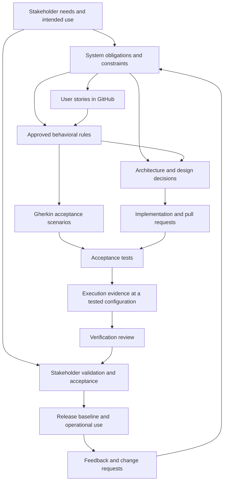

# Developing this project with lifecycle traceability

We will develop Continuous Traceability Assurance (CTA) using the traceability discipline we expect it to support: connect engineering intent, approved behavioral specifications, design decisions, implementation, verification, stakeholder acceptance, and released configurations. User stories organize delivery. Their acceptance criteria live in version-controlled Gherkin `.feature` files.

This is a project development convention, tailored to a small student team. It does not declare compliance with an industry standard. [NASA's bidirectional traceability guidance](https://swehb.nasa.gov/display/SWEHBVC/SWE-052+-+Bidirectional+Traceability) provides a useful reference for maintaining associations among requirements, design, code, verification and nonconformances. Our lifecycle also includes stakeholder validation, release and maintenance.

## Two traceability scopes

| Scope | What the records describe | Where they belong |
| --- | --- | --- |
| CTA's own development | Why this product exists, its obligations, stories, acceptance criteria, code, tests, reviews and releases. | `docs/`, project GitHub issues, `backend/`, project CI and PR history. |
| Repositories evaluated by CTA | Requirements, scenarios, implementation, tests and evidence ingested as product input. | Currently the deliberately synthetic `fixtures/banking-demo/` and its generated nested repository. |

An execution of the banking fixture's tests is evidence about that fixture. A backend test checking correct handling of fixture results is evidence about CTA. Neither result substitutes for the other. A mock finding response is not evidence that a general assurance engine exists. Preserve this distinction when CTA eventually evaluates its own repository.

Until self-ingestion is implemented, maintain project traceability with files, explicit links and reviews. Do not require the unfinished product to certify its own development or use its output to invent the expected results of its tests.

## The traceability model for development

These are typed associations, not interchangeable claims. A story delivers a requirement; a rule specifies behavior; a scenario illustrates and checks an example; a design decision explains an implementation choice; a test execution records an observation. A reviewer judges the scope supported by that evidence. Retrieve the chain in both directions rather than storing duplicate reverse links.

Do not force every requirement into a user story or executable scenario. Architecture constraints, reproducibility, documentation, risk controls and analyses can require inspection or analysis in addition to tests. Record the method, inputs, reviewer and result. Behavioral acceptance criteria still require meaningful automated checks before a story closes under the existing definition of done.

## Full lifecycle and its review points

The rows below are activities repeated for each increment, not a requirement to finish all design before implementation. Use a lightweight V-model: plan verification and validation while defining the corresponding obligations, then collect evidence as the increment is integrated.

| Activity | Questions to resolve | Minimum project record | Exit condition |
| --- | --- | --- | --- |
| 1. Problem and stakeholder needs | Who uses CTA, what decision does it support, and what problem remains after ordinary CI? | [Project definition](project-definition.md): intended use, stakeholders, scope, success measures and assumptions. | Product owner reviews the intended use and bounded research question; unresolved assumptions are visible. |
| 2. System requirements and risk | What observable system obligations follow? What could misleading assurance output cause? | Identified requirements with source, rationale, owner, status and verification method; concise risk/control register. | Requirements are understandable, feasible and reviewable; risks have owners and planned controls. |
| 3. System architecture and allocation | Which parts and interfaces fulfill each obligation? What stays outside the system? | [Architecture](architecture.md), allocation links and ADRs for material choices. | Interfaces and ownership are explicit; each in-scope obligation has a planned realization and verification approach. |
| 4. Software requirements and story refinement | What software behavior will this increment deliver? What would count as acceptance? | Existing roadmap/GitHub story plus canonical `.feature` file, source requirements/rationale and verification mapping. | Story is ready under the checklist below; no unresolved acceptance ambiguity is hidden in implementation. |
| 5. Detailed design | How will components represent state, enforce boundaries and handle errors? | Focused design notes, domain/API contracts and any necessary ADR. | A different developer can assess the design against the behavior; cross-boundary changes are reviewed. |
| 6. Implementation and unit verification | Does each implemented behavior meet its local contract? | Small issue-linked commits/PR, code, unit checks against independent expectations. | Relevant checks pass; implementation and tests have reviewer feedback addressed. |
| 7. Integration and system verification | Do components work together under the selected baseline and configuration? | Acceptance/integration runs, fixture/oracle provenance, configuration and report artifacts. | Each criterion has attributable evidence; failures, unavailable evidence and required reassessment remain distinct. |
| 8. Stakeholder validation | Does the increment solve the intended user's problem? | Scenario-based demonstration, observed user task outcomes and acceptance/disposition record. | Stakeholder accepts the intended use within stated limits, or records changes needed. A green test suite alone does not close this gate. |
| 9. Release and transition | Exactly what is released, with which evidence and limitations? | Immutable release reference, tested manifest, changes/known issues, installation/demo instructions and independent review. | Required checks and milestone criteria pass with no open major finding; owner authorizes the release. |
| 10. Operation and maintenance | Can a contributor reproduce results, diagnose issues and assess changes? | Runbook, issue/change record, baseline comparison, updated review decisions and regression evidence. | Every accepted change repeats affected lifecycle activities and produces a reviewable new baseline. |
| 11. Retirement and preservation | What happens when a version or the prototype is no longer supported? | End-of-support notice, archived source/evidence/limitations and replacement or export instructions. | Users can identify unsupported versions; historic evidence remains associated with its original configuration. |

Use existing records where possible rather than creating one document per row. Early project work has already occurred: reconstruct missing rationale honestly as retrospective documentation. Never backdate a requirement approval or claim a new specification was used to produce a historical execution.

## Gherkin acceptance criteria as the source of truth

For newly refined stories, use one file per story in the existing `docs/stories/` directory: `<STORY-ID>.feature`. A story may share a capability with other stories; one file per story is our small-project organizational choice, not a Gherkin language rule. A GitHub Feature issue (`F-01`, etc.) remains a backlog grouping and is different from the Gherkin `Feature` keyword.

Use the story's existing roadmap ID and GitHub issue number as Feature tags, such as `@FT-01 @issue-18`. Give every scenario a stable `@SCN-nnn` tag, unique within this repository's development specifications. Preserve existing AC labels as additional tags when migrating older criteria. Refer to an identity as `(repository, scenario ID)` so a benchmark's `SCN-001` cannot be confused with a CTA acceptance scenario in another repository.

For new behavioral specifications, use `Rule` for the normative behavior and `Scenario` / `Scenario Outline` for observable examples. Include a success case, a meaningful failure/invalid-input case, and relevant boundary or unknown-data cases. `Then` steps must be observable outcomes, not assertions about internal wiring or preferred prose. Descriptions and rule text do not execute by themselves; step implementations must assert what the criteria actually mean. [Official Gherkin reference](https://cucumber.io/docs/gherkin/reference/)

Existing M0 criteria retain their original names, wording and AC labels in [FT-01.feature](stories/FT-01.feature) and [FT-02.feature](stories/FT-02.feature). They specify M0 fixture/contract behavior, not the future general rule engine. Their extraction is a retrospective documentation migration, not new requirement approval.

For each story, maintain:

- The GitHub issue for intent, parent feature, priority, owner, discussion and delivery state.
- The `.feature` file for the current normative behavioral acceptance criteria.
- A Markdown companion or milestone index for upstream requirement links, design references, verification mappings and limitations.
- Test code and retained execution artifacts for actual observations; review records for engineering acceptance.

Initial issue intake may contain draft Gherkin. Once a file exists, link it at the reviewed commit from the issue/PR rather than maintaining another independent normative copy. Historical inline criteria in roadmap/review records remain historical references. If current wording disagrees, resolve the discrepancy in a reviewed change; do not silently pick the convenient version.

Do not add a runner/framework merely to store the specifications. Current M0 scenarios are checked through an explicit mapping to existing pytest tests; the `.feature` files are not yet executed by a Gherkin runner. Future direct step bindings need a scoped work item, an ADR selecting tooling, and real execution reporting. Unbound/pending scenarios must never be reported as executed passes. No unit-test duplication is required when a substantive existing test already verifies the criterion.

## A story's development loop

1. **Understand the need.** Identify the source obligation, intended user, expected benefit and relevant risk/control. Infrastructure stories may trace to an engineering constraint with an explicit rationale rather than a fabricated end-user requirement.
2. **Refine examples together.** The story owner, implementer and a different reviewer discuss positive, failure and boundary cases before implementation. The product owner resolves intended behavior; tests do not define it by accident.
3. **Baseline the criterion.** Record the `.feature` revision/hash and review disposition. Unapproved examples stay draft. Reuse existing IDs; a renamed scenario retains its logical identity, while changed content still needs reassessment.
4. **Plan verification.** Map each scenario to a substantive test selector or future binding; specify inputs, independent expected outcomes and configuration. Record non-executable obligations with their inspection/analysis method separately.
5. **Design and implement.** Update relevant contracts/ADRs, implement behavior, and add only necessary tests. Preserve issue references in commits and PRs under [CONTRIBUTING.md](../CONTRIBUTING.md).
6. **Verify and inspect the trace.** Execute checks offline; retain report and input/configuration identity. Follow links from requirement to evidence and back from changed code/test to intended behavior. A mapping row alone is not execution evidence.
7. **Validate the user outcome.** Demonstrate the workflow and record stakeholder feedback. Disposition unmet needs or assumptions explicitly.
8. **Review and integrate.** Different workstreams review cross-boundary changes. Close the story only when its criteria are verified, supporting docs/fixtures are current and required review is complete. Milestone completion additionally requires the existing independent-review gate.

**Ready for implementation:** the source obligation/rationale, owner, milestone, dependencies, canonical criteria, independent expected outcomes, verification method and design impact are recorded; scope fits the increment. A blocked or unknown decision is visible rather than invented.

**Done:** the existing repository story/milestone definitions still apply. In addition, a reviewer can follow each acceptance criterion to its test or approved nonbehavioral verification record, actual result, evaluated version and disposition. A story's delivery state, a test's outcome and a requirement's assurance status remain separate dimensions.

## Verification mapping and evidence

Use the initial [M0 verification map](stories/M0-foundation.md#acceptance-verification-map) as the transition example. Store mappings in Markdown for now; this avoids choosing another database or expanding the product API while its foundation is being established. This is project governance data, not an accepted-link graph automatically loaded by the application.

A mapping identifies the story/issue, scenario ID/criterion, verification method, exact test selector, supported scope and known limitations. A run record separately identifies the tested commit, specification and relevant artifact hashes, full invocation, timestamp, runtime/configuration, raw report reference/digest and outcomes. Evidence added in a later documentation commit retains the revision actually tested; freshness compares relevant content, not equality of commit SHAs.

For inspection/analysis, retain the reviewed input versions, procedure, reviewer, timestamp, conclusion and limitations. Do not call it a passing test execution. For direct Gherkin execution in the future, include outline-instance identity, skipped/undefined cases and all attempts. Do not infer criterion verification from “all tests passed” if the scenario has no mapping or binding.

Changes to a requirement, rule, scenario, design or source artifact trigger an impact assessment. Record the changed content, affected relationships, need for revised acceptance criteria, and the decision to rerun verification or justify reuse. Requirement changes create review obligations; only recorded failing behavior supports a failure conclusion. An issue/commit reference associates work with intent but does not prove coverage or satisfaction.

## Adoption order and current gaps

The owner's request establishes the lifecycle direction; this adoption slice is story **FT-03**
([#39](https://github.com/anthonygraca/gherkin-knowledge-graph/issues/39)) with its criteria in
[FT-03.feature](stories/FT-03.feature) and its record in [FT-03.md](stories/FT-03.md). The initial
[project definition](project-definition.md) is a draft to review before extending product
behavior. Existing M0 implementation/re-review evidence remains historical and is not rewritten by this process.

1. Review intended use, stakeholder needs, system boundary and draft system obligations; record an explicit owner disposition before calling that set an approved requirements baseline.
2. Review the M0 `.feature` extraction and test mappings. Preserve its approved snapshot and oracle attestations; do not claim a new independent approval for this documentation.
3. Complete the existing M0 landing prerequisites recorded in [STATUS.md](STATUS.md).
4. Refine the next eligible stories with canonical `.feature` criteria before their implementation. Do not create later-milestone code or empty directories to fill out the lifecycle diagram.
5. Add direct Gherkin execution and project trace validation through explicit stories when they are in scope. Start with lightweight links and evidence now; self-ingestion follows only after the product supports it.

The full lifecycle is the development process. M0–M4 remain delivery increments, not synonyms for requirements/design/test phases. Repeat the relevant activities within each increment, and preserve the existing milestone ordering and independent reviews.
